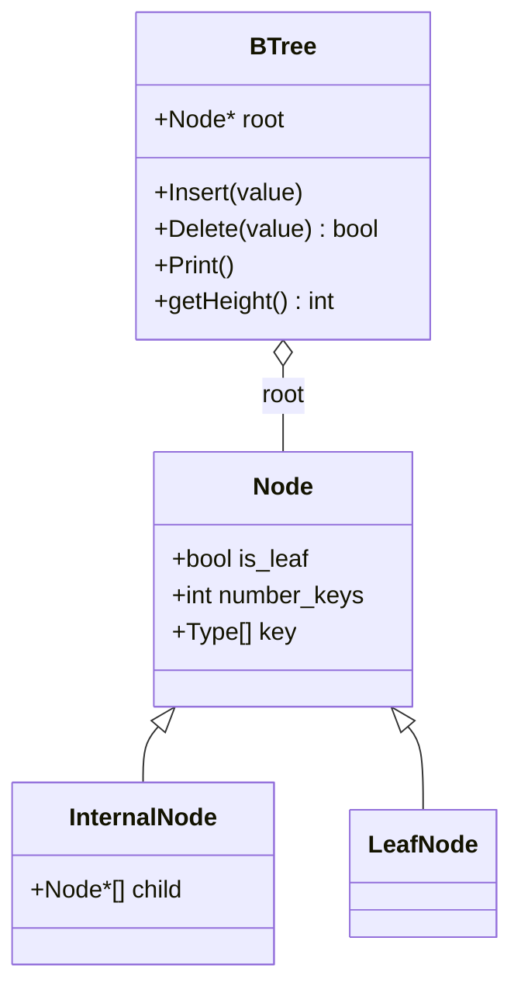
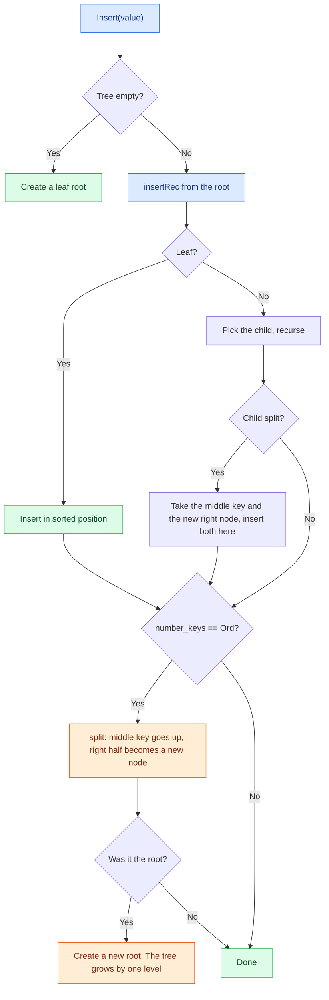
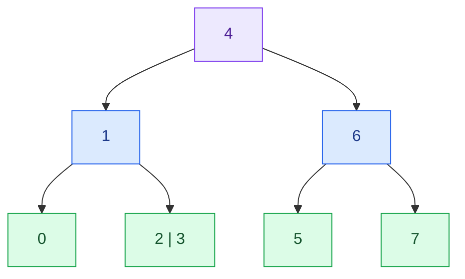
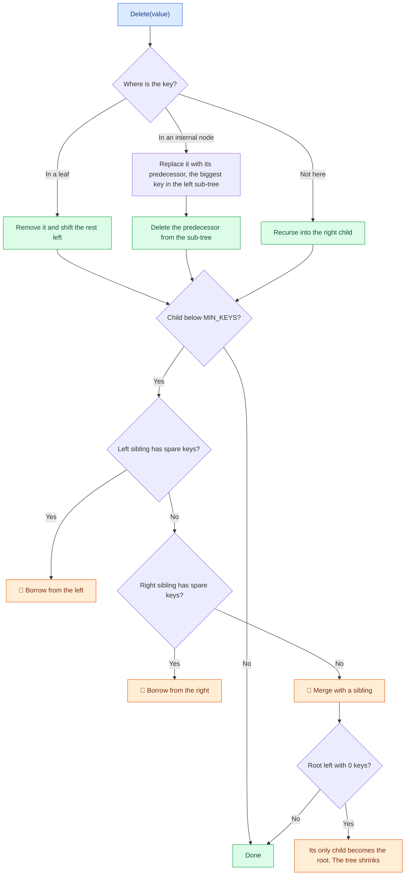
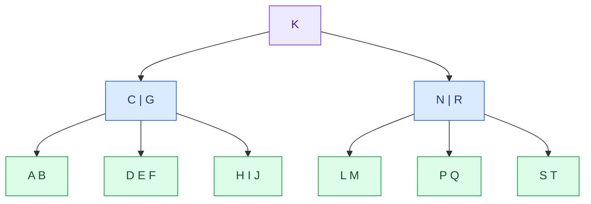

<div align="center">



<br/>


**A generic B-Tree of any order, built with inheritance: `Node`, `InternalNode` and `LeafNode`.**

[Features](#-features) · [Design](#-design) · [Insertion](#-how-insertion-works) · [Deletion](#-how-deletion-works) · [Usage](#-usage) · [Library](#-api) · [Limitations](#-notes-and-limitations) · [Team](#-team)

</div>

---

## ✨ Features

| | |
|---|---|
| 🌳 **Any order** | The order is a template parameter: `BTree<int, 3>`, `BTree<char, 5>`, ... |
| 🧬 **Inheritance design** | Leaves hold keys only. Internal nodes also hold children. No wasted pointers in leaves |
| ➕ **Insert** | Insert first, split on overflow, and the split propagates up to the root |
| ➖ **Delete** | Predecessor replacement, borrowing from siblings, merging, and shrinking the root |
| 🧩 **Generic** | Works with any type that supports `<`, `>` and `==` |
| 🖨️ **Tree printing** | Prints the tree with indentation, one node per line |
| 🧹 **No leaks** | Recursive destructors. Checked with AddressSanitizer |
| ✅ **Randomized testing** | Validated against `std::set` on thousands of random operations |

---

## 🧬 Design



| Struct | Responsibility |
|---|---|
| `Node` | Base type. Holds `is_leaf`, `number_keys` and the `key` array |
| `InternalNode` | Adds `child[Ord + 1]`, the pointers to the sub-trees |
| `LeafNode` | Nothing extra. Leaves have no children |
| `BTree` | Owns the root and implements insert, delete and print |

### 📐 Terminology

`Ord` is the **maximum number of children** of a node.

| Order | Max keys | Max children | Min keys (non-root) |
|:---:|:---:|:---:|:---:|
| 3 | 2 | 3 | 1 |
| 4 | 3 | 4 | 1 |
| 5 | 4 | 5 | 2 |
| 6 | 5 | 6 | 2 |
| 7 | 6 | 7 | 3 |

```cpp
static const int MIN_KEYS = (Ord - 1) / 2;
```

> [!NOTE]
> The `key` array has `Ord` slots, one more than the legal maximum. The extra slot holds the key that causes an overflow for a moment, right before the node is split.

---

## ➕ How insertion works



1. Go down from the root, choosing the child by comparing the value with the keys.
2. At the leaf, insert the value in its sorted position.
3. If a node reaches `Ord` keys, **split** it. The middle key goes to the parent, the left half stays, and the right half becomes a new node.
4. The parent may overflow too. The split moves up as far as needed.
5. If the **root** splits, a new root is created. This is the only way the tree gets taller.

### 🎬 Simulation: `BTree<int, 3>`

Inserting `1, 5, 0, 4, 3, 2, 6, 7`. Every node holds at most 2 keys.

**① Insert `1`**: the tree is empty, so a root leaf is created.

```
[1]
```

**② Insert `5`**: goes into the leaf, in sorted order.

```
[1 5]
```

**③ Insert `0`**: the leaf becomes `[0 1 5]`, which has 3 keys and overflows. 🔥 **Split**: the middle key `1` goes up to a new root.

```
   [1]
  /   \
[0]   [5]
```

**④ Insert `4`**: `4 > 1`, so it goes right.

```
   [1]
  /   \
[0]   [4 5]
```

**⑤ Insert `3`**: the right leaf becomes `[3 4 5]` and overflows. 🔥 **Split**: `4` goes up into the root.

```
      [1 4]
     /  |  \
  [0]  [3]  [5]
```

**⑥ Insert `2`**: `1 < 2 < 4`, so it goes into the middle leaf.

```
      [1 4]
     /  |  \
  [0] [2 3] [5]
```

**⑦ Insert `6`**: `6 > 4`, so it goes into the right leaf.

```
      [1 4]
     /  |  \
  [0] [2 3] [5 6]
```

**⑧ Insert `7`**: this one **cascades**. 🔥🔥

- The right leaf becomes `[5 6 7]` and splits. `6` goes up.
- The root becomes `[1 4 6]` with 3 keys, so it overflows and splits too. `4` goes up.
- The root was the node that split, so a **new root** is created and the tree grows to height 3.



---

## ➖ How deletion works

Deleting is harder than inserting, because every non-root node must keep at least `MIN_KEYS` keys.



| Case | What happens |
|---|---|
| 🍃 **Key in a leaf** | Remove it and shift the rest |
| 🌿 **Key in an internal node** | Replace with the predecessor, then delete the predecessor below |
| 🔄 **Borrow** | The parent's key moves down to the poor node and a spare key from the sibling moves up |
| 🧬 **Merge** | Left node + parent's key + right node become one node |
| 📉 **Shrink** | If the root ends up empty, its only child becomes the new root |

### 🎬 Simulation: continuing from the tree above

Start with the height-3 tree from step ⑧:

```
        [4]
       /    \
    [1]      [6]
   /   \    /   \
 [0] [2 3] [5]  [7]
```

**① Delete `7`**: a **cascading merge**. 🧬🧬

- Leaf `[7]` becomes empty. Its sibling `[5]` has only 1 key, so it can't lend one. **Merge** `[5]` + `6` + `[ ]` into `[5 6]`.
- The parent `[6]` is now empty. Its sibling `[1]` has only 1 key, so **merge** again: `[1]` + `4` + that node.
- The root is empty, so its only child becomes the new root. The tree **shrinks** back to height 2.

```
      [1 4]
     /  |  \
  [0] [2 3] [5 6]
```

**② Delete `6`**: a plain leaf delete, with no underflow.

```
      [1 4]
     /  |  \
  [0] [2 3] [5]
```

**③ Delete `0`**: the leaf becomes empty. 🔄 **Borrow from the right**: `1` comes down, `2` goes up.

```
      [2 4]
     /  |  \
   [1] [3] [5]
```

**④ Delete `4`**: it lives in the root, so it is replaced by its **predecessor** `3`, and then `3` is deleted from the leaf below. The leaf `[3]` is empty, its siblings have no spare keys, so it merges: `[1]` + `2` + `[ ]`.

```
     [3]
    /   \
 [1 2]  [5]
```

**⑤ Delete `1`**: a plain leaf delete.

```
     [3]
    /   \
  [2]   [5]
```

---

## 🚀 Usage

### 📁 Project files

```
.
├── B_Tree.h      # all the templates (Node, InternalNode, LeafNode, BTree)
├── B_Tree.cpp    # main()
└── assets/
    └── banner.svg
```

> [!IMPORTANT]
> Everything is in the header because C++ templates must be fully visible to the compiler where they are used.

### 🔨 Build and run

```bash
g++ -std=c++11 B_Tree.cpp -o B_Tree
./B_Tree
```

On Windows PowerShell:

```powershell
g++ B_Tree.cpp -o B_Tree
.\B_Tree
```

---

## 🧪 Example

```cpp
#include "B_Tree.h"

int main()
{
    BTree<int, 3> t;
    int a[] = {1, 5, 0, 4, 3, 2};
    for (int x : a) t.Insert(x);
    t.Print();

    t.Delete(4);
    t.Print();
    return 0;
}
```

Output:

```text
1,4
  0
  2,3
  5

1,3
  0
  2
  5
```

Each line is one node, and a child is indented two spaces under its parent.

<details>
<summary><b>🔍 A bigger one: <code>BTree&lt;char, 5&gt;</code></b></summary>

<br/>

```cpp
BTree<char, 5> t;
char c[] = {'G','I','B','J','C','A','K','E','D','S',
            'T','R','L','F','H','M','N','P','Q'};
for (char x : c) t.Insert(x);
t.Print();
```

```text
K
  C,G
    A,B
    D,E,F
    H,I,J
  N,R
    L,M
    P,Q
    S,T
```



Deleting `K`, `A` and `B` from this tree shows predecessor replacement, a borrow, and a cascading merge that shrinks the tree:

```text
Delete K  →  J               Delete A  →  J                Delete B  →  G,J,N,R
               C,G                          D,G                           C,D,E,F
                 A,B                          B,C                         H,I
                 D,E,F                        E,F                         L,M
                 H,I                          H,I                         P,Q
               N,R                          N,R                           S,T
                 ...                          ...
```

</details>

---

## 🐍 API

| Member | Description |
|---|---|
| `BTree<Type, Ord> t;` | Creates an empty tree |
| `void Insert(Type value)` | Inserts a value |
| `bool Delete(Type value)` | Deletes a value. Returns `true` if it was found |
| `void Print() const` | Prints the tree, one node per line |
| `int getHeight() const` | Number of levels. Don't call it on an empty tree |
| `NodeT* root` | The root pointer. `nullptr` when the tree is empty |

---

## 📊 Complexity

| Operation | Time | Notes |
|---|:---:|---|
| Insert | `O(log n)` | One root-to-leaf path, plus splits on the way back |
| Delete | `O(log n)` | One root-to-leaf path, plus borrows and merges on the way back |
| Print | `O(n)` | Visits every node once |
| Space | `O(n)` | |

Deleting a key from an internal node costs one extra descent to find the predecessor, which is still `O(log n)`.

---

## 📝 Notes and limitations

- **Duplicates are not handled.** `Insert` does not reject them, so the caller should avoid inserting the same value twice. `Delete` removes one occurrence.
- There is **no `Search`** function yet.
- `Ord` must be **3 or more**.
- `getHeight()` assumes a non-empty tree.
- `Print` shows the tree sideways, with indentation. It is meant for learning and debugging.
- Deletion always uses the **predecessor**. Using the successor is also valid and would give a different, equally correct tree.

---

## 👥 Team

<div align="center">


**Kareem Ahmed**

</div>

---

<div align="center">

Made with 🌳 and a lot of pointers

</div>
